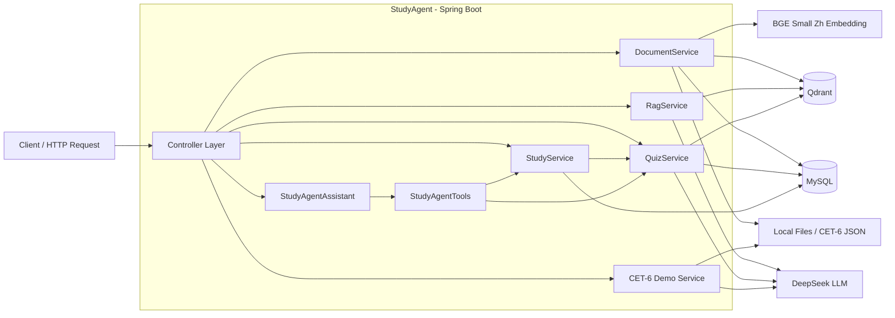
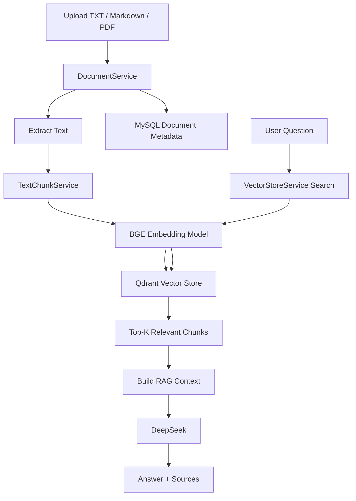
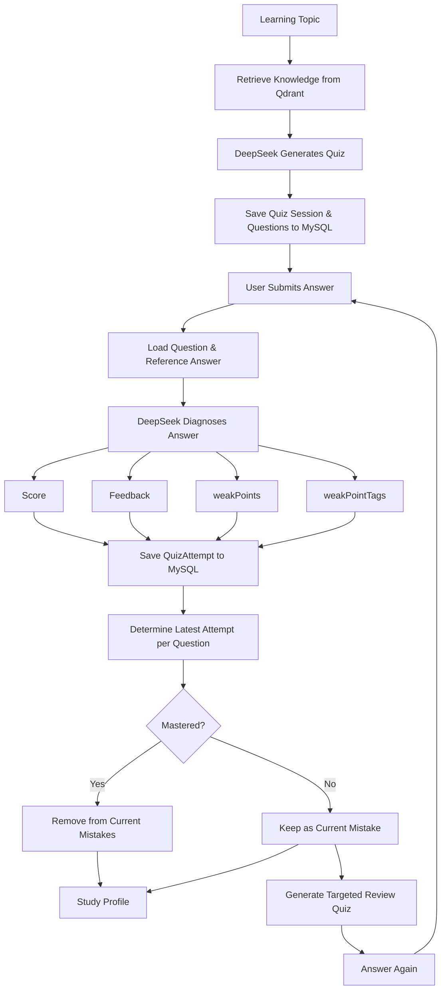
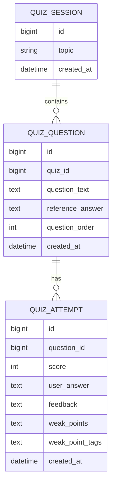

# StudyAgent

StudyAgent 是一个基于 Java、LangChain4j、RAG 与 Tool Calling 构建的个性化学习诊断 Agent。

项目不仅提供知识库问答能力，还围绕“学习 → 测试 → 诊断 → 复习”构建学习闭环：用户可以上传个人学习资料，通过 RAG 生成诊断题，提交答案后由系统识别薄弱知识点，并进一步生成针对性的讲解、复习题和学习建议。

项目同时提供了一个 CET-6 学习诊断 Demo，用真实阅读作答数据验证自动批改、错题分析、题型诊断和学习画像能力。


## Core Features

| Module | Description |
| --- | --- |
| Personal Knowledge Base | 支持 TXT、Markdown、PDF 文档上传、解析、切分和向量化 |
| RAG Q&A | 根据个人知识库检索相关内容，并结合 DeepSeek 生成回答 |
| Quiz Generation | 基于知识库内容自动生成学习诊断题 |
| Answer Diagnosis | 对用户答案进行评分、错因分析和薄弱知识点提取 |
| Weak Point Tracking | 通过标准化 weakPointTags 聚合学习薄弱点 |
| Mistake Review | 维护当前未掌握错题，并支持针对性讲解与复习题生成 |
| Study Profile | 根据真实作答记录生成当前学习画像和复习建议 |
| Tool Calling Agent | 通过自然语言查询学习画像、错题，并按需生成复习题 |
| CET-6 Demo | 对真实阅读答案进行自动批改和 AI 诊断，并演示听力、写作、翻译处理能力 |


## Learning Loop

StudyAgent 的核心业务流程为：

```text
学习资料
   ↓
文档解析
   ↓
文本切分
   ↓
Embedding
   ↓
Qdrant 向量库
   ↓
RAG 检索
   ↓
生成诊断题
   ↓
用户作答
   ↓
Java 确定性业务判断 + LLM 语义诊断
   ↓
weakPoints / weakPointTags
   ↓
错题与学习画像
   ↓
针对性讲解 / 复习题
   ↓
再次作答
   ↓
掌握状态更新

```

## Tech Stack

| Layer | Technology |
| --- | --- |
| Language | Java 17 |
| Backend | Spring Boot 3.5.16 |
| Persistence | MyBatis-Plus 3.5.17 |
| Database | MySQL |
| LLM Framework | LangChain4j 1.20.0 |
| LLM | DeepSeek |
| Embedding | BGE Small Zh v1.5 |
| Vector Database | Qdrant 1.18.3 |
| Document Parsing | Apache PDFBox 3.0.8 |
| Container | Docker / Docker Compose |
| Build Tool | Maven |


## Architecture



### Knowledge Base & RAG Flow



### Learning Diagnosis Flow



## Database Design

StudyAgent 当前使用 MySQL 保存文档元数据、学习记录、题目和作答历史。

向量数据不存储在 MySQL 中，而是保存到 Qdrant。

### Core Tables

#### `knowledge_document`

保存用户上传到个人知识库中的文档元数据。

| Field | Description |
| --- | --- |
| id | 文档主键 |
| original_filename | 用户上传时的原始文件名 |
| stored_filename | 服务器本地保存文件名 |
| file_size | 文件大小 |
| content_type | 文件 MIME 类型 |
| file_hash | 文件 SHA-256，用于重复文件检测 |
| created_at | 创建时间 |

文档正文经过解析和切分后生成 Embedding，向量及相关 metadata 存储到 Qdrant。


#### `learning_record`

保存基础学习诊断记录。

| Field | Description |
| --- | --- |
| id | 主键 |
| topic | 学习主题 |
| description | 用户描述的学习问题 |
| created_at | 创建时间 |


#### `quiz_session`

表示一次题目生成任务。

| Field | Description |
| --- | --- |
| id | Quiz Session 主键 |
| topic | 本次题目的学习主题 |
| created_at | 创建时间 |


#### `quiz_question`

保存 AI 生成的题目及参考答案。

| Field | Description |
| --- | --- |
| id | 题目主键 |
| quiz_id | 所属 Quiz Session |
| question_text | 题目内容 |
| reference_answer | 参考答案 |
| question_order | 题目在本次 Quiz 中的顺序 |
| created_at | 创建时间 |


#### `quiz_attempt`

保存用户每一次作答及 AI 诊断结果。

| Field | Description |
| --- | --- |
| id | 作答记录主键 |
| question_id | 对应题目 |
| user_answer | 用户答案 |
| score | AI 诊断分数 |
| feedback | AI 生成的详细反馈 |
| weak_points | 详细薄弱点列表 |
| weak_point_tags | 标准化薄弱知识标签 |
| created_at | 作答时间 |

`weak_points` 用于向用户展示具体问题，`weak_point_tags` 用于系统进行稳定的薄弱知识统计。


### Logical Relationships



这里表示的是当前代码中的逻辑关系。

当前 V1 没有强制建立数据库 Foreign Key，题目和作答之间的关联由业务代码维护。


### Current Mistake Rule

StudyAgent 不会因为一道题历史上曾经答错，就永久将其保留在错题本中。

系统按照每道题的最近一次作答判断当前掌握状态：

```text
Question
   ↓
All Attempts
   ↓
Latest Attempt
   ↓
score >= 60 AND weakPointTags is empty
   ↓
Mastered

otherwise
   ↓
Current Mistake
```

因此用户重新答对一道题后：

- 历史错误作答仍然保存在数据库中；
- 该题会从当前错题列表中移除；
- 学习画像随之更新。


## API Overview

### System

| Method | Endpoint | Description |
| --- | --- | --- |
| GET | `/api/health` | 服务健康检查 |


### Personal Knowledge Base

| Method | Endpoint | Description |
| --- | --- | --- |
| POST | `/api/documents/upload` | 上传 TXT / Markdown / PDF 学习资料 |
| GET | `/api/documents` | 查询知识库文档 |
| DELETE | `/api/documents/{id}` | 删除文档、对应本地文件和向量数据 |
| POST | `/api/search` | 直接进行向量相似度检索 |
| POST | `/api/rag/chat` | 基于个人知识库进行 RAG 问答 |


### Quiz & Diagnosis

| Method | Endpoint | Description |
| --- | --- | --- |
| POST | `/api/quiz/generate` | 基于知识库生成诊断题 |
| POST | `/api/quiz/submit` | 提交答案并进行 AI 学习诊断 |
| GET | `/api/quiz/attempts` | 查询历史作答记录 |
| GET | `/api/quiz/weak-points` | 聚合历史薄弱知识点 |
| GET | `/api/quiz/mistakes` | 查询当前仍未掌握的题目 |
| POST | `/api/quiz/review` | 针对一次错误作答生成复习讲解 |
| POST | `/api/quiz/review/generate` | 针对薄弱点生成新的复习题 |


### Study Profile

| Method | Endpoint | Description |
| --- | --- | --- |
| POST | `/api/study/diagnose` | 基础学习问题诊断 |
| GET | `/api/study/records` | 查询学习诊断记录 |
| GET | `/api/study/profile` | 获取当前个性化学习画像 |


### Study Agent

| Method | Endpoint | Description |
| --- | --- | --- |
| POST | `/api/agent/chat` | 使用自然语言与 Tool Calling Study Agent 交互 |

Study Agent 当前提供三个核心 Tool：

```text
getStudyProfile()
→ 查询当前学习画像

getCurrentMistakes()
→ 查询当前未掌握题目

generateReviewQuiz(attemptId, questionCount)
→ 在用户明确要求时生成针对性复习题
```

对于只读问题，Agent 不会调用具有创建题目副作用的 Tool。


### CET-6 Demo

最终 Demo 主入口：

| Method | Endpoint | Description |
| --- | --- | --- |
| GET | `/api/demo/cet6/report` | 生成完整 CET-6 学习诊断 Demo Report |

其中：

```text
Reading
→ real user answers
→ Java deterministic grading
→ AI section-level diagnosis
→ learning profile

Listening
→ synthetic demo answers
→ Java deterministic grading

Writing
→ synthetic demo answer
→ AI diagnostic evaluation

Translation
→ synthetic demo answer
→ AI diagnostic evaluation
```

Writing 和 Translation 返回的 `score` 为 `ai_diagnostic_score`，不是官方 CET-6 分数。


### Development / Verification APIs

以下接口主要用于开发过程中验证 CET-6 各阶段能力：

| Method | Endpoint | Description |
| --- | --- | --- |
| GET | `/api/demo/cet6/preview` | 预览阅读错题 |
| GET | `/api/demo/cet6/diagnose-first` | 诊断第一道阅读错题 |
| GET | `/api/demo/cet6/diagnose-three` | 诊断前三道阅读错题 |
| GET | `/api/demo/cet6/diagnose/{questionNo}` | 按题号诊断阅读错题 |
| GET | `/api/demo/cet6/reading-report` | 生成阅读客观批改报告 |
| GET | `/api/demo/cet6/reading-diagnosis` | 按题型批量进行 AI 阅读诊断 |
| GET | `/api/demo/cet6/reading-profile` | 生成真实阅读学习画像 |
| GET | `/api/demo/cet6/demo-listening-report` | synthetic 听力批改 Demo |
| GET | `/api/demo/cet6/demo-writing-evaluation` | synthetic 作文 AI 评价 |
| GET | `/api/demo/cet6/demo-translation-evaluation` | synthetic 翻译 AI 评价 |


## Quick Start

### Prerequisites

运行 StudyAgent 需要：

- JDK 17
- MySQL 8.x
- Docker / Docker Compose
- DeepSeek API Key


### 1. Clone Project

```bash
git clone https://github.com/XiHe2002/study-agent.git
cd study-agent
```


### 2. Initialize MySQL

执行：

```text
sql/init.sql
```

脚本会创建：

```text
study_agent

knowledge_document
learning_record
quiz_session
quiz_question
quiz_attempt
```


### 3. Start Qdrant

项目使用 Docker Compose 启动 Qdrant：

```bash
docker compose up -d
```

当前镜像版本：

```text
qdrant/qdrant:v1.18.3
```

端口：

```text
6333 - REST API / Dashboard
6334 - gRPC used by StudyAgent
```

Qdrant 数据通过 Docker named volume 持久化。

> `docker compose down` 不会删除向量数据。  
> 如果执行 `docker compose down -v`，则会同时删除对应 volume。


### 4. Create Qdrant Collection

当前 V1 尚未自动创建 Collection，因此首次运行需要创建：

```text
Collection: studyagent_knowledge
Vector size: 512
Distance: Cosine
```

可以通过 Qdrant REST API 创建：

```bash
curl -X PUT http://localhost:6333/collections/studyagent_knowledge \
  -H "Content-Type: application/json" \
  -d "{\"vectors\":{\"size\":512,\"distance\":\"Cosine\"}}"
```

Windows PowerShell 也可以使用：

```powershell
Invoke-RestMethod `
  -Method Put `
  -Uri "http://localhost:6333/collections/studyagent_knowledge" `
  -ContentType "application/json" `
  -Body '{"vectors":{"size":512,"distance":"Cosine"}}'
```


### 5. Configure Environment Variables

StudyAgent 不会将 API Key 或数据库密码提交到 Git。

运行前请配置：

```text
DEEPSEEK_API_KEY
SPRING_DATASOURCE_PASSWORD
```

数据库默认配置：

```text
Host: 127.0.0.1
Port: 3306
Database: study_agent
Username: root
```

请不要将真实密钥或密码写入 Git 仓库。


### 6. Run Application

Windows：

```bash
mvnw.cmd spring-boot:run
```

macOS / Linux：

```bash
./mvnw spring-boot:run
```

默认服务地址：

```text
http://localhost:8080
```


### 7. Verify

访问：

```http
GET http://localhost:8080/api/health
```

正常情况下返回：

```json
{
  "status": "ok",
  "project": "StudyAgent"
}
```

之后可以通过 `requests.http` 测试知识库、RAG、Quiz、Study Agent 和 CET-6 Demo 等接口。


## Key Design Principle

StudyAgent 将确定性业务逻辑与大模型能力进行明确分工。

Java 负责答案比对、分数统计、最新作答状态、学习优先级等可以确定性计算的业务规则。

LLM 负责自然语言理解、错因分析、知识点提取、个性化讲解以及主观题评价。

例如在 CET-6 阅读诊断中：

```text
Java
→ 判断答案是否正确
→ 统计题型正确率
→ 确定最薄弱题型

DeepSeek
→ 分析为什么答错
→ 提取共同错误模式
→ 生成 weakPointTags
→ 给出学习建议
```

这样既利用大模型的语义能力，又避免让 LLM 决定本可以由程序准确计算的事实。


## CET-6 Demo

项目使用一套 CET-6 试卷构建了完整学习诊断案例。

其中 Reading 使用真实作答数据，用于验证真实学习诊断流程。

Listening、Writing 和 Translation 使用 synthetic demo 数据，仅用于测试系统功能，不代表用户真实英语水平。

Writing 与 Translation 中的评分为 AI diagnostic score，不属于官方 CET-6 分数。

当前真实 Reading Demo：

```text
30 questions
15 correct
15 wrong
Accuracy: 50%

Section A: 20%
Section B: 60%
Section C: 70%

Priority Review:
Section A - Word Bank Cloze
```

系统进一步识别出 Section A 的主要薄弱点包括词性辨析、固定搭配、句法结构、上下文语义和干扰项辨析，并自动将其设为当前优先复习方向。


## Demo Showcase

### 1. RAG Knowledge Q&A

用户上传个人学习资料后，StudyAgent 会完成：

```text
Document
→ Parse
→ Chunk
→ Embedding
→ Qdrant
→ Similarity Search
→ DeepSeek
→ Answer + Sources
```

RAG 回答只使用检索到的知识库内容作为主要上下文，并返回相关 source chunks，减少脱离个人学习资料进行回答的情况。


### 2. Personalized Learning Diagnosis

系统可以基于知识库生成诊断题，并保存题目与参考答案。

用户提交答案后：

```text
Question + Reference Answer + User Answer
                ↓
             DeepSeek
                ↓
Score + Feedback
+ weakPoints
+ weakPointTags
                ↓
           QuizAttempt
                ↓
Latest Attempt per Question
                ↓
Current Mistakes / Study Profile
```

如果用户针对同一道题重新作答并达到掌握条件，历史错误记录仍然保留，但该题会自动移出当前错题列表。


### 3. Tool Calling Study Agent

StudyAgent 支持通过自然语言调用学习工具。

示例：

```text
User:
我现在还有哪些题没有掌握？

Agent:
→ 调用 getCurrentMistakes()
→ 返回当前错题
→ 不创建新的题目
```

当用户明确提出生成复习题时：

```text
User:
根据这道错题给我生成 2 道复习题。

Agent:
→ 调用 generateReviewQuiz(...)
→ 根据薄弱知识点检索知识库
→ 生成针对性复习题
→ 保存新的 Quiz Session
```

只读查询与具有副作用的操作型 Tool 被明确区分，避免普通查询意外创建数据。


### 4. CET-6 Learning Diagnosis Demo

最终 Demo Endpoint：

```http
GET /api/demo/cet6/report
```

一次真实测试结果：

```text
Reading
30 questions
15 correct
15 wrong
Accuracy: 50%

Section A: 20%
Section B: 60%
Section C: 70%

Priority Section:
Section A
```

系统进一步通过 AI 批量分析阅读错题，识别出：

```text
词性辨析
固定搭配
句法结构
上下文语义
干扰项辨析
```

等主要薄弱能力，并由 Java 根据客观正确率将 Section A 设置为当前优先复习题型。

Listening Demo：

```text
Data Source: synthetic
25 questions
15 correct
Accuracy: 60%
```

Writing 和 Translation 使用 synthetic answer 验证主观题诊断能力。

示例结果：

```text
Writing
AI Diagnostic Score: 72
Word Count: 167

Translation
AI Diagnostic Score: 74
Word Count: 105
```

AI 能够进一步识别主谓一致、动词形式、名词单复数、冠词、词汇搭配和表达自然度等问题。

> CET-6 Demo 中只有 Reading 使用真实作答数据。
> Listening、Writing 和 Translation 使用 synthetic demo 数据。
> AI diagnostic score 不代表官方 CET-6 分数。


## Known Limitations

当前 StudyAgent V1 聚焦核心学习诊断闭环，仍存在以下限制：

- PDF 目前通过 PDFBox 提取文本层，不支持扫描件和手写内容 OCR。
- 文本切分目前采用固定字符长度策略，可能出现语义边界被截断的问题。
- 文件系统、MySQL 与 Qdrant 之间尚未实现跨存储事务，异常情况下可能出现数据不一致。
- LLM 需要返回结构化 JSON，虽然进行了格式校验，但仍可能因为模型输出异常导致请求失败。
- `weakPointTags` 主要依赖 Prompt 进行标准化，仍可能出现标签语义漂移。
- 当前版本以单用户学习场景为核心，没有实现用户认证、权限隔离和多租户能力。
- Qdrant Collection 目前需要首次启动时手动创建。
- CET-6 最终报告包含多次串行 LLM 调用，一次完整报告在当前环境下约需要几十秒，暂未实现缓存或并行优化。
- CET-6 本地测试数据位于 `data/`，该目录被 Git 忽略，因此真实试卷和个人作答数据不会提交到公开仓库。

这些限制属于当前 V1 的明确边界，而不是已经实现但未展示的能力。


## Project Status

StudyAgent V1 已完成核心功能开发与端到端验证。

当前版本已经实现：

```text
Personal Knowledge Base
→ RAG
→ Quiz Generation
→ Answer Diagnosis
→ Weak Point Tracking
→ Current Mistakes
→ Personalized Review
→ Study Profile
→ Tool Calling Agent
```

同时通过 CET-6 场景验证了：

```text
Objective Grading
→ Mistake Analysis
→ Section-level Diagnosis
→ Learning Profile
→ Subjective Answer Evaluation
```

项目当前进入工程整理与面试复盘阶段，不再继续扩展 Redis、Kafka、微服务、Multi-Agent 等与核心问题无直接关系的技术。

后续优化方向主要包括 OCR、语义切分、自动初始化 Qdrant Collection、数据一致性增强以及 LLM 调用性能优化。


